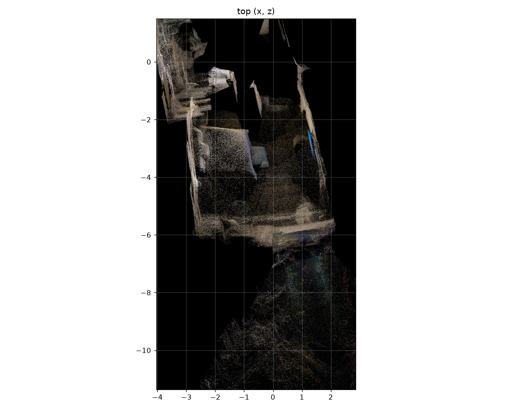
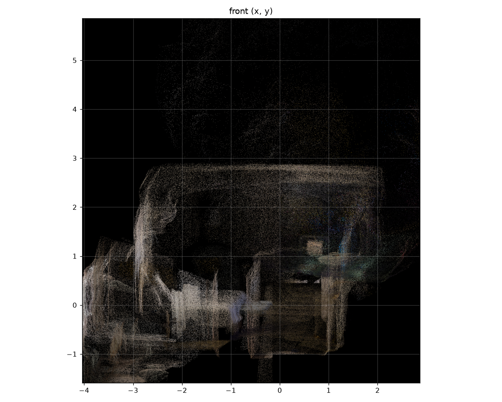

# 내 방을 알갱이로 — 03-07 실습

폰으로 찍은 영상 하나에서 3차원 장면을 만들고, 가우시안 스플랫으로 바꿔 브라우저에서 돌려 보는 실습 결과입니다.
복원은 수업 노트북(`room3d.ipynb`)을 코랩 T4에서 돌렸고, 뷰어는 수업 저장소의 `index.html`을 썼습니다.

**뷰어 주소: https://flyjay-phx.github.io/room-3d/** (장면 파일: scene.sog)

## 공개 판단

촬영한 방에 **사람이 찍혀 있었습니다.** 그대로 올리면 3D에도 그대로 남기 때문에, 복원한 알갱이 중 사람이 있던 구역(861,215개)을 지우고 올렸습니다.
지운 뒤 뷰어에서 돌려 보며 사람이 보이지 않는 것을 확인했고, 지운 자리에는 구멍이 생겼습니다. 사람이 나온 원본 파일은 올리지 않았습니다.
화면에 얼굴, 이름, 주소 같은 개인정보가 없는지 올리기 전에 한 번 더 확인했습니다.

## 촬영

| 항목 | 값 |
|---|---|
| 촬영한 곳 | 내 방 (방 안을 걸어 다니며) |
| 영상 | 폰으로 찍은 가로 영상 (길이·해상도는 기록하지 못함) |
| 추출한 프레임 | 기록하지 못함 (점 개수 기준 노트북 표의 약 50장 분량) |

## 복원 (실습 1)

| 항목 | 값 |
|---|---|
| 모델 | `facebook/map-anything-apache`, fp16 |
| GPU | 코랩 Tesla T4 |
| 모델 준비 | 239초 (4.91GB 내려받기) |
| 복원 시간 | 26.0초 |
| 최대 GPU 메모리 | 8.58GB |
| 점 개수 | 7,231,323 → 튄 점 제거 후 7,042,003 |
| 카메라 퍼짐 비 | **0.3873** (카메라 상자 대각선 7.27 ÷ 장면 대각선 18.76) |

퍼짐 비가 기준(0.1)보다 훨씬 커서 제자리에서 돈 것이 아니라 걸어 다니며 찍은 것이 확인됐습니다.

## 사람 지우기 (교안 외 추가 단계)

| 항목 | 내용 |
|---|---|
| 방법 | 알갱이를 위·앞·옆에서 본 그림으로 그려 사람이 있는 구역을 찾고, 그 상자 안의 알갱이를 지움 |
| 지운 상자 | x −0.15~0.85, z −1.5~1.7, y −1.8~0.45 |
| 결과 | 7,042,003개 → **6,180,788개** (861,215개 제거) |
| 도구 | 코랩에서 받은 `.sog`를 `splat-transform@3.10.3`으로 PLY로 풀고, 파이썬으로 걸러 낸 뒤 다시 `.sog`로 줄임 |

## 알갱이로 바꾸고 줄이기 (실습 2·3)

알갱이 반지름 = K × 장면의 가장 긴 변 ÷ √N, K=1.4. 코랩에서 만든 PLY는 알갱이당 **68바이트**(17칸)였습니다.

같은 PLY(사람을 지운 판, 6,180,788개)를 `npx -y @playcanvas/splat-transform@3.10.3 -w` 로 세 형식으로 바꿔 비교했습니다 (Windows, CPU 모드).

| 형식 | 파일 크기 (바이트) | 원본 대비 | 알갱이 개수 | 알갱이당 바이트 | 변환 시간 |
|---|---:|---:|---:|---:|---:|
| `.ply` (splat-transform이 쓴 14칸 형식) | 346,124,491 | 100% | 6,180,788 | 56.0 | — |
| `.compressed.ply` | 100,631,638 | 29.1% | 6,180,788 | 16.28 | 16.5초 |
| `.sog` | 27,760,351 | 8.0% | 6,180,788 | 4.49 | 10.8초 |
| `.spz` | 40,668,112 | 11.7% | 6,180,788 | 6.58 | 17.8초 |

- 변환 시간은 도구 기동(npx)을 포함한 실제 시간이고, 알갱이 개수는 도구가 알려 준 값입니다. 세 파일 모두 같습니다.
- 크기는 줄었지만 그릴 알갱이 수는 같습니다. 그래서 파일이 작아져도 화면을 돌릴 때의 부드러움은 같습니다.
- **Pages에는 `.sog`를 골랐습니다.** 가장 작고, Spark 2.1.0이 읽을 수 있는 SOG v2입니다. `.compressed.ply`는 100MB를 넘어 GitHub에 그대로 올리기 어렵습니다.
- 코랩에서 만든 원본 PLY는 478.9MB였고, `.sog`로 바꾸자 31.2MB(15.4배 감소)가 됐습니다. (사람을 지우기 전 값)

## 뷰어

three.js + Spark, 빌드 없이 `index.html` 하나로 엽니다. 회전·확대·이동, 위아래 뒤집기, 알갱이 퍼짐 조절.

| 기기·환경 | `scene.sog` 받는 시간 (뷰어 표시) |
|---|---|
| 같은 컴퓨터 로컬 서버 | (측정 예정) |
| GitHub Pages, 데스크톱 브라우저(Windows) | 3.9초 (뷰어 표시, 26.5MB) |
| 내 폰 | (측정 예정) |
| 다른 사람 폰 | (측정 예정) |

알갱이가 618만 개라서 폰에서는 느릴 수 있습니다.

## 잘 보이는 방향과 무너지는 방향




(위 두 그림은 뷰어 화면이 아니라, 알갱이 중심점을 위·앞에서 그린 것입니다.)

**잘 보이는 방향:** 걸어 다니며 촬영한 쪽입니다. 같은 부분이 여러 사진에 이어서 찍혀 시차로 깊이를 구할 수 있었습니다.

**무너지는 방향:** 사람을 지운 자리와 한 번도 찍히지 않은 면입니다. 점이 없는 곳은 알갱이 크기를 키워도 채워지지 않아서, 다시 찍어야 합니다.

**지운 자리의 구멍:** 사람이 서 있던 곳 주변은 바닥과 벽까지 함께 잘려 나갔습니다.

## 다음에 바꿀 것

- 처음부터 **사람이 없을 때** 찍기 (지우는 것보다 결과도 좋고 안전함)
- 평가용 사진을 따로 빼 두고 PSNR·SSIM·LPIPS로 비교하기

## 파일

```
├── index.html        뷰어
├── scene.sog         줄인 알갱이 파일 (6,180,788개, 약 26.5MB)
├── .nojekyll         GitHub Pages가 파일 이름을 건드리지 않게 하는 표시
├── README.md         이 문서
└── shots/
    ├── points_top.png    알갱이 중심점 — 위에서
    └── points_front.png  알갱이 중심점 — 앞에서
```
